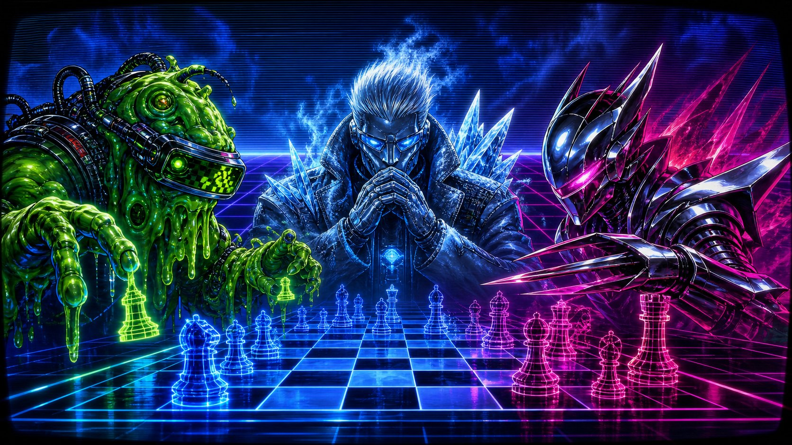
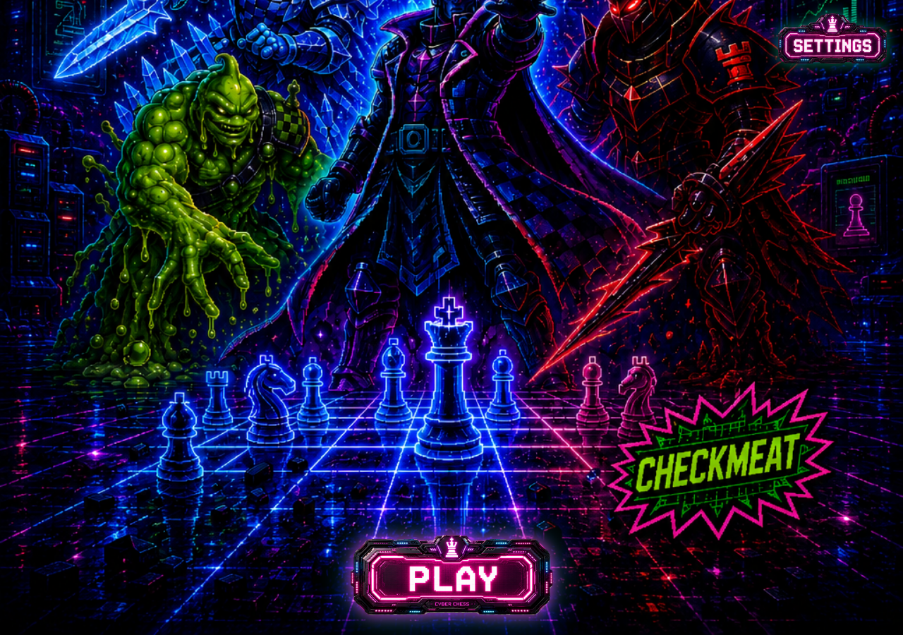
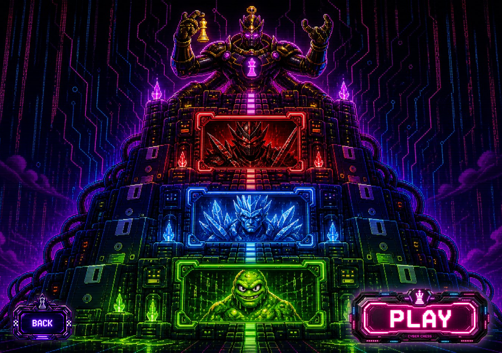
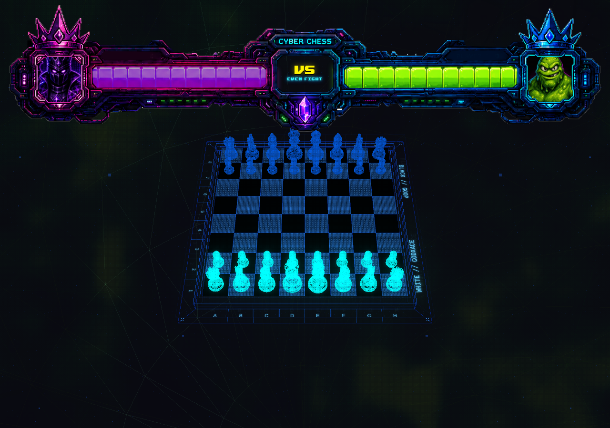
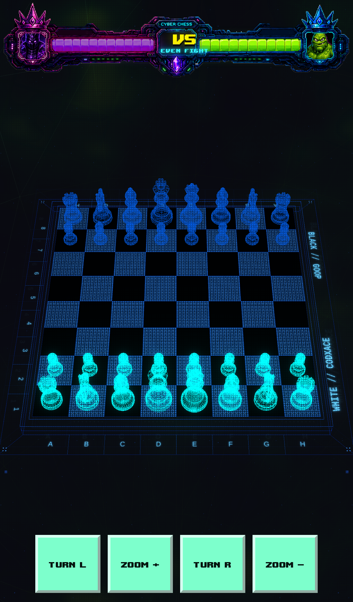

# Codex Chess

<p align="center">
  
</p>

<p align="center">
  <strong>Cyber Chess</strong><br>
  One-player 3D arcade chess for the browser. No backend required.
</p>

<p align="center">
  <a href="https://newjordan.github.io/codex-chess/">Play Cyber Chess</a>
  &nbsp;|&nbsp;
  <a href="media/chessagent-intro.mp4">Watch the intro MP4</a>
</p>

---

## Challenge Submission

- Public GitHub repo: <https://github.com/newjordan/codex-chess>
- Playable game link: <https://newjordan.github.io/codex-chess/>
- Short description: a static browser chess campaign where you climb a cyber arcade tower, fight three local AI personalities, and face GORDO, a final boss powered by the embedded Lozza chess engine.

## What I Made

Codex Chess is a one-player browser game built with React, Three.js, chess.js, and a static asset pipeline. It has animated 3D chess pieces, a story intro, opponent reveal screens, local audio controls, a two-life continue system, a final boss, and a local leaderboard saved in `localStorage`.

No API keys, `.env` files, backend services, or runtime AI API calls are required. The game is designed to run as a static site on GitHub Pages, itch.io, Vercel, or any plain HTTP server.

## Opening Cinema

<p align="center">
  <a href="media/chessagent-intro.mp4">
    
  </a>
</p>

<video src="media/chessagent-intro.mp4" controls width="900"></video>

If the video player does not appear in your browser, open `media/chessagent-intro.mp4`.

## Screenshots

<p align="center">
  
</p>

<p align="center">
  
</p>

<p align="center">
  
</p>

<p align="center">
  
</p>

## How To Play

1. Press `PLAY` to boot the cabinet, then press `PLAY` again to name your fighter.
2. Enter your fighter name and press `LOCK IN`.
3. Watch the story, or press `SKIP`.
4. Choose `Play White` or `Play Black`, then press `CONTINUE`.
5. Review the tower floor, then press `ASCEND`.
6. Click or tap a piece, then click or tap a legal destination square.
7. Checkmate the current enemy to climb to the next floor.
8. Clear Goop, Frostd4d, Razorblade, and GORDO to post a local leaderboard score.

## Controls

- Mouse, trackpad, or touch: select and move pieces. A tap stays a tap, so dragging the camera does not play a move.
- Touch screens, while a match is on: `TURN L`, `TURN R`, `ZOOM +`, and `ZOOM -` sit under the board.
- `Esc`: open the in-game pause/settings panel.
- `RESET BOARD`: restart the current matchup from the pause panel.
- `MAIN MENU`: return to the intro and setup flow.
- `CONTINUE`: spend one remaining life after a loss.
- If the browser cannot create a WebGL2 context, the board is replaced by a display-link failure message instead of a blank canvas.

## What Is In The Cartridge

- 3D chess board built with React, Three.js, and chess.js.
- Animated FBX chess pieces.
- Three local AI personalities plus GORDO, a final boss backed by the embedded Lozza chess engine worker.
- Fixed floppy-tower campaign progression.
- Two-life continue system.
- Player name registration.
- Smart 3D board labels: white name on the white side, black name on the black side.
- Local leaderboard saved in `localStorage`.
- Browser-generated chiptune intro music.
- Browser-generated gameplay SFX for menu actions, reveals, moves, captures, checks, wins, losses, and countdown ticks.
- Settings panel with Full Audio, SFX Only, and Muted modes.
- Static generated art and audio assets.
- Embedded Lozza chess engine worker, included under its MIT license in `media/engines/`.

## How Codex Helped

Codex helped turn the prototype into a playable static browser game, build the campaign structure, debug the 3D board and name placement, add the player profile and local leaderboard, shape the story/tower/enemy art direction, package the static assets, add audio controls, and verify the game with automated browser smoke tests.

All non-Lozza opponents are local chess heuristics written for this game. Codex was the only AI coding assistant used to build and package the project.

## One-Command Local Play

From a fresh clone:

```bash
npm run play
```

That command installs locked dependencies, builds the Vite bundle into `dist/`, and starts the local preview. Open `http://127.0.0.1:5173/`.

## Local Development

```bash
npm ci
npm run dev
```

`npm run dev` serves the source with Vite on `http://127.0.0.1:5173/`. `npm start` previews the production build on the same address.

## Rebuild

```bash
npm run build
```

Vite writes `dist/` with a relative asset base, so the same output works for a local preview and for GitHub Pages at `/codex-chess/`. The build copies `media/`, `avatars/`, `pieces_fbx/`, and `music/` next to `index.html`. `dist/` is not committed.

## Verify

```bash
npm test
npm run preflight
```

`npm test` runs the chess rules, perft, campaign, pointer, and WebGL checks. Perft covers the standard starting position and positions 2 through 6. `npm run preflight` builds, tests, and plays the campaign in a headless browser.

To verify a deployed copy:

```bash
SMOKE_URL=https://newjordan.github.io/codex-chess/ npm run smoke
```

## Hosting

GitHub Actions builds and deploys `dist/` to GitHub Pages on every push to `main` (`.github/workflows/pages.yml`). Pull requests run the test and production build (`.github/workflows/ci.yml`).

To publish somewhere else, run `npm run build` and serve `dist/` as a static site. The page, hashed assets, and copied media folders need to stay together.

## Attributions

See `ATTRIBUTIONS.md` for Lozza, ElevenLabs/Suno audio notes, fonts, and asset notices.
